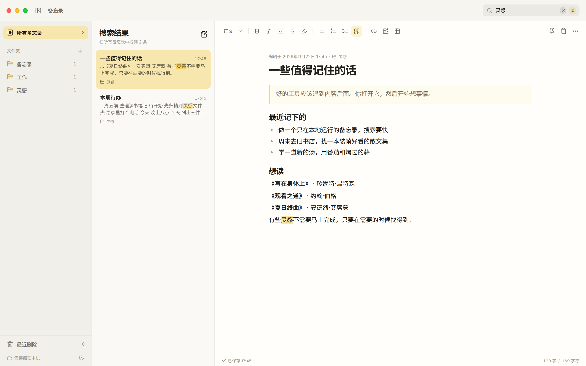
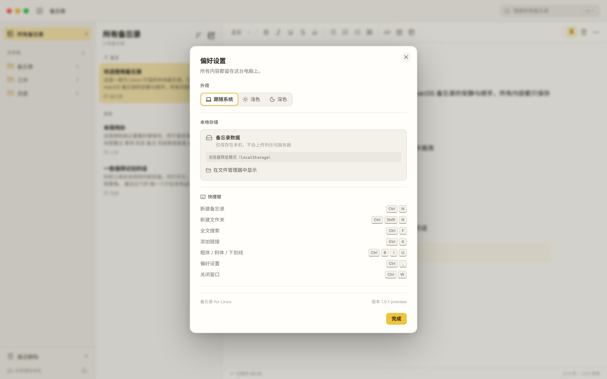

<p align="center">
  
</p>

<h1 align="center">FreeNotes · 本地优先的备忘录</h1>

<p align="center">
  一款受 macOS 备忘录启发的本地笔记应用：安静、顺手，所有内容只留在你的电脑上。
</p>

<p align="center">
  <em>A local-first, macOS Notes-inspired note-taking app for macOS, Windows and Linux.</em>
</p>

<p align="center">
  <a href="https://github.com/dzb/freenotes/releases/latest"></a>
  <a href="https://github.com/dzb/freenotes/blob/main/LICENSE"></a>
  
  
</p>

<p align="center">
  <a href="https://github.com/dzb/freenotes/releases/latest">下载最新版本</a> ·
  <a href="#开发">从源码运行</a>
</p>


## 为什么是它

- **像 macOS 备忘录一样工作**：三栏布局、暖白色纸张、金色选中态、无边框窗口控制，以及克制的动效。
- **一个入口找到全部内容**：顶部搜索框跨文件夹搜索标题和正文，支持多个关键词、英文大小写与重音忽略；结果片段与正文内都会高亮命中词。
- **专注写字**：标题、正文自动保存；支持标题样式、加粗、斜体、下划线、删除线、高亮、引用、项目符号、编号列表、待办清单、链接、图片和表格；正文默认 14px，可在偏好设置中调整字号和系统/衬线/等宽字体。
- **真正把数据留在本地**：主数据使用 SQLite（WAL + 事务），图片保存为附件文件并通过索引关联；每天自动保留一个轻量数据库快照。
- **方便迁移和分享**：可导出/恢复完整 ZIP 备份包，也可把单条备忘录导出为自包含 HTML 或 PDF。
- **桌面应用该有的细节**：文件夹、置顶、最近删除、拖拽归档、排序、深色模式、系统外观跟随、快捷键和原生右键编辑菜单。

| 全文搜索与正文高亮 | 表格与待办 |
| --- | --- |
|  |  |

| 深色外观 | 偏好设置 |
| --- | --- |
|  |  |

## 下载

当前版本为 **1.0.9**，可从 [GitHub Releases](https://github.com/dzb/freenotes/releases/latest) 下载。

| 平台 | 推荐产物 |
| --- | --- |
| macOS Apple Silicon | `FreeNotes-1.0.9-arm64.dmg` 或 `.zip` |
| macOS Intel | `FreeNotes-1.0.9-x64.dmg` 或 `.zip` |
| Windows x64 | `FreeNotes-1.0.9-x64.exe` |
| Linux x86_64 | `FreeNotes-1.0.9-x86_64.AppImage`、`.deb` 或 `.rpm` |

> macOS 构建使用 ad-hoc 签名，但没有 Developer ID 证书和 notarization。首次打开仍可能触发 Gatekeeper 提示；如果系统显示“无法验证”，可在“系统设置 → 隐私与安全性”中选择“仍要打开”。Windows 未签名构建可能触发 SmartScreen 提示。

### macOS

下载 DMG 后打开，将 FreeNotes 拖入“应用程序”即可。使用 ZIP 时解压后同样拖入“应用程序”。

当前 macOS 包使用 ad-hoc 签名，但没有 Apple Developer ID 公证。如果首次启动提示应用已损坏或被拦截，可执行：

```bash
xattr -dr com.apple.quarantine /Applications/FreeNotes.app
codesign --force --deep --sign - /Applications/FreeNotes.app
open /Applications/FreeNotes.app
```

也可以尝试“系统设置 → 隐私与安全性 → 仍要打开”。要彻底消除 Gatekeeper 提示，需要在发布流程中配置 Developer ID 证书并完成 notarization。

FreeNotes 使用 macOS 原生红黄绿窗口按钮和原生应用菜单；Windows/Linux 保持应用内自绘的标题栏样式。

### Windows

下载 `FreeNotes-1.0.9-x64.exe`，运行 NSIS 安装程序。安装时可选择目标目录。

### Linux

RPM 包可以被 Fedora 自带软件中心或 PackageKit 打开安装，也可以通过 `dnf` 安装。注意 RPM 不是 Flatpak 包。

```bash
# Fedora / RHEL
sudo dnf install ./FreeNotes-1.0.9-x86_64.rpm

# Debian / Ubuntu
sudo apt install ./FreeNotes-1.0.9-amd64.deb

# AppImage
chmod +x FreeNotes-1.0.9-x86_64.AppImage
./FreeNotes-1.0.9-x86_64.AppImage
```

如果系统限制了 Electron 的 SUID sandbox，AppImage 可以显式关闭 Chromium sandbox（仅建议在信任的本地构建上这样做）：

```bash
./FreeNotes-1.0.9-x86_64.AppImage --no-sandbox
```

## 从旧版 MacNotes 迁移

FreeNotes 首次启动时会检查旧版 MacNotes 的数据目录。如果新目录还没有数据，会自动复制：

- `notes-data.json`
- `backups/`

随后会把 `notes-data.json` 一次性导入新的 `notes.db`，其中的 base64 图片会迁移到附件目录。旧 JSON 不会被移动或删除；迁移后 `notes.db` + `attachments/` 是唯一主数据，如果要回退到旧版本，请先导出完整备份。

## 使用

首次启动会创建 3 条示例备忘录和 3 个文件夹，都可以直接修改或删除。

- 点击左上角侧栏按钮或按 `Ctrl/⌘ N` 新建备忘录。
- 点击文件夹区块右侧的 `+` 新建文件夹；悬停文件夹可重命名或删除。
- 把备忘录拖到左侧文件夹，或拖到“最近删除”，可以快速整理。
- 顶部搜索框是全局入口，搜索所有未删除的备忘录。
- 正文上方工具条可以切换样式、插入清单/表格/图片、添加链接。
- 编辑器右上角 `···` 菜单可以导出当前备忘录为 HTML 或 PDF。
- 偏好设置 → 外观可以调整正文字号和字体族。
- 偏好设置 → 本地存储可以导出完整备份或从备份恢复。

### 快捷键

| 操作 | macOS | Windows / Linux |
| --- | --- | --- |
| 新建备忘录 | `⌘ N` | `Ctrl N` |
| 新建文件夹 | `⌘ ⇧ N` | `Ctrl Shift N` |
| 全文搜索 | `⌘ F` | `Ctrl F` |
| 加粗 / 斜体 / 下划线 | `⌘ B` / `⌘ I` / `⌘ U` | `Ctrl B` / `Ctrl I` / `Ctrl U` |
| 添加链接 | `⌘ K` | `Ctrl K` |
| 偏好设置 | `⌘ ,` | `Ctrl ,` |
| 关闭窗口 | `⌘ W` | `Ctrl W` |
| 退出应用 | `⌘ Q` | `Ctrl Q` |

在正文中，`Command/Ctrl + 单击` 链接会在系统浏览器中打开；右键编辑区可以使用系统编辑菜单。搜索框内按 `Esc` 清空搜索。

## 数据、备份与导出

数据目录：

- macOS：`~/Library/Application Support/FreeNotes/`
- Windows：`%APPDATA%\FreeNotes\`
- Linux：`~/.config/FreeNotes/`

主要文件：

- 主数据：`notes.db`（SQLite，WAL 模式）
- 图片附件：`attachments/<hash 前两位>/<sha256>.<扩展名>`
- 旧版数据文件：首次迁移时保留 `notes-data.json`，之后不再作为主存储
- 每日数据库快照：`backups/notes-YYYY-MM-DD.db`，保留最近 10 份
- 恢复前快照：`backups/pre-restore-YYYY-MM-DD-HHmmss.db`，保留最近 5 份

### 完整备份

用于跨设备迁移或完整恢复。导出文件是一个 ZIP 包：

```text
FreeNotes-backup-2026-11-23-1830.freenotes.zip
├── backup.json
└── attachments/
```

`backup.json` 记录文件夹、笔记、最近删除、设置和图片附件索引；`attachments/` 保存实际图片文件。恢复时会：

1. 校验备份格式
2. 显示数据预览
3. 确认后自动创建当前数据快照
4. 在 SQLite 事务中重建恢复数据

“从备份恢复…”也兼容旧版 `.freenotes.json` 或 `notes-data.json`，其中的 base64 图片会自动迁移成附件。

### 单条导出

编辑器 `···` 菜单支持：

- 导出为 HTML：导出时把附件临时内联，生成自包含、离线可读的文件
- 导出为 PDF：与 HTML 共用同一份排版，适合直接分享

单条导出只包含笔记标题和正文，不包含应用界面、内部 ID 或文件夹等元数据。

## 技术栈与设计

- **Electron 45 + React 19 + TypeScript 5 + Vite 8**
- **TipTap 3 / ProseMirror** 负责结构化富文本编辑、撤销栈、任务清单、表格与图片节点
- **CSS 变量 + 原生 `Highlight` API** 实现浅色/深色主题与正文搜索高亮
- **Inter** 作为拉丁字体（本地打包），中文回退到系统字体
- **macOS 原生窗口按钮和原生应用菜单**
- **Windows/Linux 自绘标题栏**
- **主进程**使用 Electron 内置 SQLite（`node:sqlite`）保存笔记：WAL + 事务 + 行级增量更新、关闭前同步 flush、每日数据库快照。图片保存为附件文件，通过自定义协议加载
- **预加载脚本**通过 `contextBridge` 暴露窄接口；渲染进程没有 Node.js 访问权限，生产构建带 CSP

全文搜索保持现有语义：按空白拆分为多个“必须同时命中”的词，也支持 `"用引号包住的短语"`。SQLite 负责持久化，渲染进程维护归一化后的内存搜索缓存；搜索关闭时不建索引，搜索开启后只重新处理发生变化的笔记。

## 项目结构

```text
src/
  main/         Electron 主进程：窗口、IPC、SQLite 数据库、附件、迁移、备份包、菜单、HTML/PDF 导出
  preload/      contextBridge 暴露的安全 API
  renderer/
    components/ 界面组件（侧栏、列表、编辑器、工具条、弹窗）
    hooks/      笔记状态、主题、正文搜索高亮
    lib/        搜索、日期、种子数据、数据规范化、HTML 导出
    styles/     全局与富文本样式
  shared/       主进程与渲染进程共享类型、备份校验、文件名处理
build/          应用图标源文件、ICNS/ICO 和多尺寸图标
docs/           截图
tests/          搜索、日期、SQLite、备份、导出和迁移单元测试
.github/        macOS / Windows / Linux 构建 workflow
```

## 开发

需要 Node.js 22+。

```bash
npm install
npm run dev
```

其他命令：

```bash
npm run typecheck   # TypeScript 检查
npm test            # 单元测试
npm run build       # 构建 renderer + main/preload
npm run dist        # 构建当前平台安装包
npm run dist:mac    # macOS DMG + ZIP
npm run dist:win    # Windows NSIS
npm run dist:linux  # Linux AppImage + deb + rpm
```

macOS 开发环境会使用原生窗口和菜单。Linux 下 npm 附带的 Electron 二进制通常没有 setuid 的 `chrome-sandbox`，因此开发脚本只在 Linux 自动追加 `--no-sandbox`；正式安装包仍应尽量保留 sandbox。

GitHub Actions 会构建 macOS arm64/x64、Windows x64 和 Linux x64 产物。正式分发建议配置：

- macOS Developer ID 签名与 notarization
- Windows 代码签名证书

## 已知限制

- macOS 开发构建当前未签名/未公证。
- Windows 安装包由 CI 构建，当前未签名。
- 完整备份恢复为整体覆盖，不提供合并恢复。
- 单条 HTML/PDF 导出不提供反向导入。
- 图片附件目前采用追加式存储，不会自动清理不再引用的文件；后续可增加安全清理功能。
- 只有本地存储，没有同步、协作、加密或账号功能。
- 单窗口；多开会被 Electron 的单实例锁合并到一个窗口。
- 这是独立项目，与 Apple 无关联；macOS 与备忘录是 Apple Inc. 的商标。界面只是对 macOS 备忘录视觉语言的致敬。

## License

MIT © 2026 FreeNotes contributors
