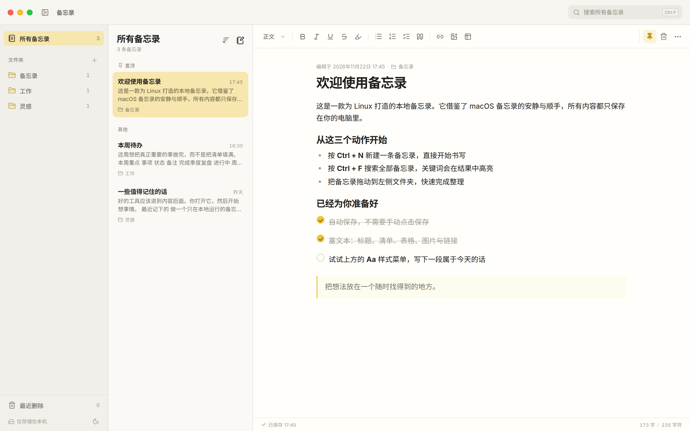
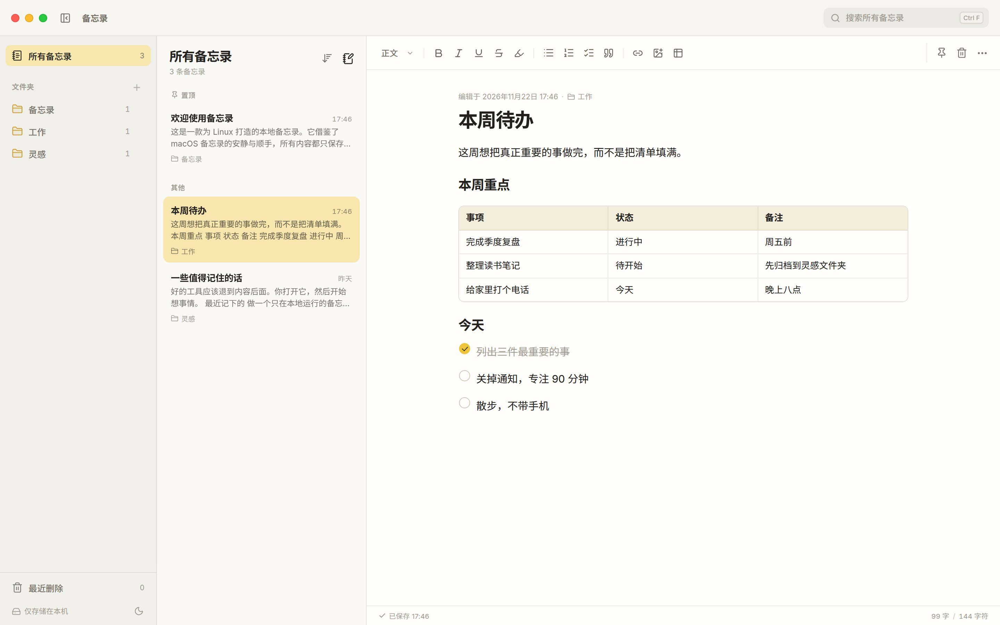
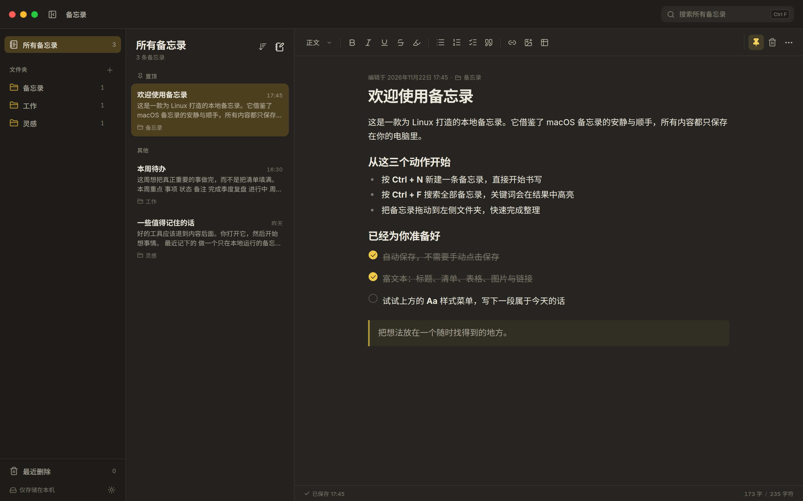

<p align="center">
  
</p>

<h1 align="center">MacNotes · 备忘录 for Linux</h1>

<p align="center">
  一款受 macOS 备忘录启发的本地笔记应用：安静、顺手，所有内容只留在你的电脑上。
</p>

<p align="center">
  <em>A local-first, macOS Notes-inspired note-taking app for Linux.</em>
</p>

<p align="center">
  <a href="https://github.com/dzb/macnotes/releases/latest"></a>
  <a href="https://github.com/dzb/macnotes/blob/main/LICENSE"></a>
  
  
</p>

<p align="center">
  <a href="https://github.com/dzb/macnotes/releases/download/v1.0.1/MacNotes-1.0.1-amd64.deb">下载 .deb</a> ·
  <a href="https://github.com/dzb/macnotes/releases/download/v1.0.1/MacNotes-1.0.1-x86_64.AppImage">下载 AppImage</a> ·
  <a href="#开发">从源码运行</a>
</p>



## 为什么是它

- **像 macOS 备忘录一样工作**：三栏布局、暖白色纸张、金色选中态、无边框窗口控制，以及克制的动效。
- **一个入口找到全部内容**：顶部搜索框跨文件夹搜索标题和正文，支持多个关键词、英文大小写与重音忽略；结果片段与正文内都会高亮命中词。
- **专注写字**：标题、正文自动保存；支持标题样式、加粗、斜体、下划线、删除线、高亮、引用、项目符号、编号列表、待办清单、链接、图片和表格。
- **真正把数据留在本地**：笔记以可读的 JSON 文件保存，原子写入，并在窗口关闭前同步落盘；每天自动保留一个备份，最多 10 份。
- **桌面应用该有的细节**：文件夹、置顶、最近删除、拖拽归档、排序、深色模式、系统外观跟随、快捷键和原生右键编辑菜单。

| 全文搜索与正文高亮 | 表格与待办 |
| --- | --- |
|  |  |

| 深色外观 | 偏好设置 |
| --- | --- |
|  |  |

## 安装

当前发布版本为 **1.0.1**（x86_64），可从 [GitHub Releases](https://github.com/dzb/macnotes/releases/latest) 下载。

### Ubuntu / Debian（推荐）

```bash
curl -LO https://github.com/dzb/macnotes/releases/download/v1.0.1/MacNotes-1.0.1-amd64.deb
sudo apt install ./MacNotes-1.0.1-amd64.deb
```

安装后从应用菜单打开 **MacNotes** 即可。Debian 包会处理 Electron 的 AppArmor / sandbox 配置，因此不需要额外的启动参数。

### AppImage（便携）

```bash
curl -LO https://github.com/dzb/macnotes/releases/download/v1.0.1/MacNotes-1.0.1-x86_64.AppImage
chmod +x MacNotes-1.0.1-x86_64.AppImage
./MacNotes-1.0.1-x86_64.AppImage
```

如果系统限制了 Electron 的 SUID sandbox，AppImage 可能无法启动，可以显式关闭 Chromium sandbox（只建议在信任的本地构建上这样做）：

```bash
./MacNotes-1.0.1-x86_64.AppImage --no-sandbox
```

### 从源码运行

```bash
git clone https://github.com/dzb/macnotes.git
cd macnotes
npm install
npm run dev
```

本地打包使用 `npm run dist`，产物位于 `release/`。

## 使用

首次启动会创建 3 条示例备忘录和 3 个文件夹，都可以直接修改或删除。

- 点击左上角 **编辑** 图标或按 `Ctrl N` 新建备忘录。
- 点击文件夹区块右侧的 `+` 新建文件夹；悬停文件夹可重命名或删除。
- 把备忘录拖到左侧文件夹，或拖到“最近删除”，可以快速整理。
- 顶部搜索框是全局入口，搜索所有未删除的备忘录。
- 正文上方工具条可以切换样式、插入清单/表格/图片、添加链接。窗口变窄时，被收起的选项会进入 `···` 菜单。

### 快捷键

| 操作 | 快捷键 |
| --- | --- |
| 新建备忘录 | `Ctrl N` |
| 新建文件夹 | `Ctrl Shift N` |
| 全文搜索 | `Ctrl F` |
| 加粗 / 斜体 / 下划线 | `Ctrl B` / `Ctrl I` / `Ctrl U` |
| 添加链接 | `Ctrl K` |
| 偏好设置 | `Ctrl ,` |
| 关闭窗口 | `Ctrl W` / `Ctrl Q` |
| 在列表中上下移动 | `↑` / `↓` |

在正文中，`Ctrl + 单击` 链接会在系统浏览器中打开；右键编辑区可以使用系统编辑菜单。搜索框内按 `Esc` 清空搜索。

## 数据与隐私

- 数据目录：`~/.config/MacNotes/`
- 主数据文件：`~/.config/MacNotes/notes-data.json`
- 自动备份：`~/.config/MacNotes/backups/notes-YYYY-MM-DD.json`，保留最近 10 个每日备份
- 首次保存后的数据不会上传到任何服务器；应用没有遥测、账号或云同步。
- 图片会压缩后以 base64 内嵌在笔记中，因此主数据文件可能随图片增加。图片会优先转为 WebP 并限制最长边为 1800px；GIF 保留原格式。
- 数据是普通 JSON，未加密。如果你会记录敏感信息，请确保系统磁盘加密（例如 LUKS）和账户安全。
- 想导出或迁移，直接备份 `notes-data.json` 即可；也可以在偏好设置中打开数据目录。

## 技术栈与设计

- **Electron 45 + React 19 + TypeScript 5 + Vite 8**
- **TipTap 3 / ProseMirror** 负责结构化富文本编辑、撤销栈、任务清单、表格与图片节点
- **CSS 变量 + 原生 `Highlight` API** 实现浅色/深色主题与正文搜索高亮
- **Inter** 作为拉丁字体（本地打包），中文回退到系统的 Noto Sans CJK / 苹方等字体
- **无边框 BrowserWindow**、自定义窗口按钮与可拖拽标题栏
- **主进程**负责文件持久化：临时文件 + `fsync` + `rename` 的原子写入、关闭前同步 flush、每日备份轮换
- **预加载脚本**通过 `contextBridge` 暴露窄接口；渲染进程没有 Node.js 访问权限，生产构建带 CSP

全文搜索在渲染进程内存中执行：按空白拆分为多个“必须同时命中”的词，也支持 `"用引号包住的短语"`。对个人备忘录规模足够，且不需要维护额外的索引文件；修改后会即时反映在搜索结果中。

## 项目结构

```text
src/
  main/         Electron 主进程：窗口、IPC、数据文件、备份、右键菜单
  preload/      contextBridge 暴露的安全 API
  renderer/
    components/ 界面组件（侧栏、列表、编辑器、工具条、弹窗）
    hooks/      笔记状态、主题、正文搜索高亮
    lib/        搜索、日期、种子数据、数据规范化
    styles/     全局与富文本样式
  shared/       主进程与渲染进程共享类型
build/          应用图标源文件与多尺寸图标
docs/           截图
tests/          搜索、日期与数据规范化单元测试
```

## 开发

需要 Node.js 22+。

```bash
npm install
npm run dev
```

开发脚本会启动 Vite 并打开 Electron。当前 Linux 下 npm 附带的 Electron 二进制通常没有 setuid 的 `chrome-sandbox`，因此开发脚本默认带 `--no-sandbox` 启动，以便本地调试；正式安装包由 `.deb` 的安装脚本按系统能力处理 sandbox/AppArmor。

如果 npm 的安装脚本被安全策略拦截（例如 npm 12 的 allowScripts），可手动下载 Electron 运行时：

```bash
node node_modules/electron/install.js
```

其他命令：

```bash
npm run typecheck   # TypeScript 检查
npm test            # 单元测试
npm run build       # 构建 renderer + main/preload
npm run dist        # 构建 AppImage 与 .deb（输出到 release/）
```

Debian 包的 `Depends` 同时兼容 Ubuntu 22.04/24.04 及 24.04+ 的 `t64` 包名。项目主页与仓库地址已写入 `package.json`，会一并进入 Debian 包元数据。

## 参与贡献

欢迎提交 Issue、功能建议或 Pull Request。这个项目刻意保持小而专注：本地优先、无需账号、搜索直达内容。提交前请至少运行：

```bash
npm run typecheck
npm test
```

## 已知限制

- 仅面向 Linux 桌面，当前打包架构为 x86_64。
- 只有本地存储，没有同步、协作、加密或账号功能。
- 单窗口；多开会被 Electron 的单实例锁合并到一个窗口。
- 图片内嵌使大文件的数据文件变大；没有单独的附件管理界面。
- 这是独立项目，与 Apple 无关联；macOS 与备忘录是 Apple Inc. 的商标。界面只是对 macOS 备忘录视觉语言的致敬。

## License

MIT © 2026 MacNotes contributors
